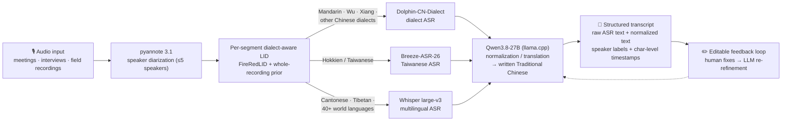

# YaYan-AI（雅言）


> **Fully-offline multi-dialect speech-AI system.**
> Converts speech across **22 Chinese dialects and 40+ world languages** into structured
> Traditional-Chinese transcripts — with speaker diarization, character-level timestamps,
> and an LLM normalization stage with a human-editable feedback loop. Designed for **air-gapped, privacy-critical
> environments**: no cloud, no API calls, no data leaving the machine.

---

## Why YaYan-AI

Off-the-shelf ASR works for Mandarin and English. It falls apart on **low-resource
Chinese dialects** — Hokkien (Taiwanese), Hakka, Wu, Cantonese variants — exactly the
speech that matters in real-world field recordings, interviews, and oral-history
preservation. And in privacy-critical settings, shipping audio to a cloud API is not
an option at all.

YaYan-AI addresses both: each segment is routed to a dialect-specialised engine, and
everything runs on local GPUs. Accuracy still varies widely by dialect — from about 9%
CER on read Mandarin to about 59% on Gan — see [Performance](#performance).

## Pipeline Architecture



The diagram shows the **deployed** configuration. The repo's `configs/default.yaml` ships
conservative defaults; the deployment enables `asr.lid_backend: firered`,
`asr.lid_call_prior: true` and `asr.force_whisper_routings: [yue, yue-hk, yue-gz, bo]`.
With the repo default (`lid_backend: voxlingua`, a single "Chinese" label) dialects are
not told apart and routing has little effect — see [Performance](#performance).

**Design decisions that matter:**
- **Per-segment language ID** — a single conversation can mix Mandarin, Hokkien and
  English; routing each segment independently prevents one dominant language from
  swallowing the others.
- **Engine routing** — Dolphin for most Chinese dialects, Breeze-ASR-26 for Hokkien,
  Whisper large-v3 for Cantonese, Tibetan and other languages. On the same public test set,
  routing gives 22.3% CER versus 37.6% for Whisper alone and 30.8% for Dolphin alone.
- **LLM normalization / translation stage** — Qwen3.8-27B (GGUF Q4_K_M, served by llama.cpp)
  turns ASR output into readable written Traditional Chinese (punctuation, fillers, wording;
  foreign-language segments are translated).
  It is **not** a verbatim corrector — see [Performance](#performance) — so the raw ASR
  text is always kept alongside the normalized text.
- **Human-in-the-loop** — the user can edit the transcript and re-run normalization;
  word-level fixes can be saved to a term bank that is applied to later transcripts
  (deterministic replacement on ASR output + term hints in the LLM prompt; both off in the
  repo defaults). The effect of this loop on accuracy has not been measured yet.

## Features

| Capability | Detail |
|---|---|
| Chinese dialects | 22 supported by the dialect ASR — Mandarin, Cantonese, Hokkien/Taiwanese, Hakka, Wu (Shanghai/Suzhou/Wenzhou), Xiang, Gan, … — 7 evaluated on public data so far (see Performance). Hakka and Gan have no LID label and must be selected manually |
| World languages | 40+ via Whisper large-v3 (JA / KO / EU / SEA / ME) |
| Speaker diarization | Up to 5 speakers (A–E), pyannote 3.1 |
| Timestamps | Character-level |
| Output | Structured Traditional-Chinese transcript, per-speaker |
| Normalization | Qwen3.8-27B → written Traditional Chinese + editable feedback loop (Qwen3-14B NF4 as in-process fallback) |
| Deployment | 100 % offline — air-gapped & privacy-critical environments |
| Interface | Gradio web UI · batch mode (`auto_batch_rtx6000.py`) |
| AI assistant | Optional Q&A tab backed by the same local LLM — ask questions or have it summarize the current transcript (off by default, `tools.enable_ai_chat`) |
| Dialect LID | Dialect-aware language ID (FireRedLID) with an optional whole-recording prior (`asr.lid_call_prior`). An experimental two-step "rescue" also exists but is off by default and not recommended: on FLEURS Vietnamese, Lao, Thai and Burmese it re-routed 54–87% of genuine foreign speech to Chinese dialects |

## Requirements

| Component | Spec |
|---|---|
| OS | Ubuntu 22.04+ |
| GPU | 2× NVIDIA — primary: **RTX 6000 24 GB** (`app_rtx6000.py`) · also supported: **RTX 4000 Ada 20 GB** (`app_rtx4000.py`) |
| Driver / CUDA | 535+ / CUDA 12.1 |
| Python | 3.10 |
| Disk | ~100 GB (deployed models ≈ 36 GB; optional Qwen3-14B fallback +28 GB; plus workspace) |
| RAM | 32 GB+ |

Core stack: PyTorch 2.3.1 · transformers 4.51.3 · pyannote.audio 3.1 · Gradio 4.44

## Quickstart

```bash
git clone https://github.com/wu840407/YaYan_AI.git
cd YaYan_AI
pip install -r requirements.txt

# Download models (online phase; the system runs fully offline afterwards)
bash scripts/download_models.sh
python scripts/verify_models.py

# Launch — pick the profile matching your GPUs
python app_rtx6000.py     # dual RTX 6000 (primary) → Gradio UI on http://localhost:7860
python app_rtx4000.py     # dual RTX 4000 Ada

# Batch mode
bash scripts/start_batch.sh
```

For fully air-gapped installation, see `scripts/install_offline.sh` and
`scripts/verify_offline.py`.

## Performance

Measured 2026-11 with the deployed configuration on **public corpora only**:
10 test groups, 3,831 utterances, 54,453 characters (each group ≥ 200 utterances and
≥ 5,000 characters). Metric is **character error rate (CER, lower is better)** on the raw
ASR output: punctuation removed, both sides converted to Simplified script before
comparison, no LLM post-processing, no diarization. Brackets are 95% bootstrap
confidence intervals.

| Test set | Style | Utt. | CER |
|---|---|---|---|
| Mandarin — FLEURS `cmn_hans_cn` test | read | 200 | 9.4% |
| Mandarin — Common Voice 22 `zh-TW` test | read, Taiwan accent | 599 | 9.6% |
| Henan (Zhengzhou) — MagicHub | conversational | 391 | 13.3% |
| Tianjin — MagicHub | conversational | 472 | 17.3% |
| Cantonese — FLEURS `yue_hant_hk` test | read, written Chinese | 200 | 14.5% |
| Cantonese — Common Voice 22 `yue` test | read, colloquial | 467 | 19.8% |
| Shanghainese (Wu) — MagicHub | conversational | 274 | 30.3% |
| Changsha (Xiang) — MagicHub | conversational | 229 | 36.1% |
| Nanchang (Gan) — MagicHub | conversational | 310 | 59.2% |
| **All 9 groups above** | | **3,142** | **22.3%** (21.5–23.0) |

- **Mandarin read speech: 9.5%.** About half of the FLEURS errors come from digits and Latin
  words written differently from the reference (e.g. "80211" vs "八零二點"); pure-Chinese
  sentences are 6.2%.
- **Hokkien / Taiwanese is not in the table.** Breeze-ASR-26 outputs a Mandarin rendering
  (e.g. 伊無佮意你 → 他不喜歡妳), so CER against Taiwanese-Han references (Common Voice
  `nan-tw`, 689 utt.) is not meaningful. A Mandarin-translation reference set would be needed.
- **Gan** is not in the language-ID label set, so it is never routed specifically.
- **Coverage:** the dialect ASR supports 22 Chinese dialects; 7 of them (plus Tianjin) have
  been evaluated on public data so far.

**Routing ablation** (same 9 groups, raw ASR CER):

| Configuration | CER |
|---|---|
| Deployed routing (FireRedLID → Dolphin / Breeze / Whisper) | **22.3%** (21.5–23.0) |
| Oracle: correct language given manually | 21.3% (20.6–22.0) |
| Generic LID (VoxLingua107, repo default) | 35.3% (33.9–36.8) |
| Dolphin only | 30.8% (30.0–31.7) |
| Whisper large-v3 only | 37.6% (36.6–38.6) |

Dialect LID accuracy (FireRedLID): Hokkien 95.8%, Cantonese 97.3%, Wu 97.4%, Xiang 91.7%,
Mandarin 90.7%. VoxLingua107 labels every Chinese dialect as "Chinese" (0% for each dialect).
Automatic LID is within 1 point of the oracle; the largest single source of the gap is
short Mandarin clips misidentified as a foreign language (2% of the Taiwan-accent set,
which produces 44% of that set's errors).

**LLM normalization is not error correction.** Feeding the raw ASR text through the LLM
stage *raises* CER against verbatim references (12.6% → 16.3% with Qwen3.8-27B at
temperature 0, 5 groups / 29,413 characters; 18.5% at the deployed temperature 0.6), because it removes fillers and
repetitions and rewrites into written style. It occasionally completes fragments with
words that were not spoken, and when ASR emits garbage it can produce fluent but wrong
text. Qwen3-14B NF4 is statistically indistinguishable (15.6%). This is why the UI keeps
the raw ASR transcript next to the normalized one.

**Speaker diarization** — AISHELL-4 test (20 far-field meetings, 12.7 h, 5–7 speakers,
first array channel): DER **21.2%** with the 5-speaker cap (collar 0.25 s). The cap is
binding — every meeting comes out as exactly 5 speakers; raising it to 8 gives 9.0%.
Two-speaker recordings are unaffected by the cap.

**Speed** (2× Quadro RTX 6000, Turing): a 39-minute meeting with auto LID, diarization
and LLM normalization takes 15.8 min end-to-end (RTF 0.40, ≈ 24 min per audio hour).
ASR alone is RTF ≈ 0.04; the LLM (≈ 24 tok/s, llama.cpp Q4_K_M) accounts for ~75% of
wall time.

**Offline check (simulated)** — with all outbound sockets blocked (`scripts/verify_offline.py --audio …`),
full transcription of Mandarin, Hokkien and Cantonese clips including the LLM stage
succeeded with zero outbound connection attempts.

Corpora and licenses: FLEURS (CC-BY 4.0), Common Voice 22 (CC-0), MagicHub dialect
conversations (CC-BY-NC-ND 4.0), AISHELL-4 (CC-BY-SA 4.0). Evaluation scripts:
`scripts/evaluate_asr.py`, `scripts/evaluate_llm.py`.

## Roadmap

- [ ] Larger ASR / LLM models on newer GPUs to lift dialect accuracy
- [x] RAG term-bank for domain / dialect vocabulary (`rag.enable_rag`, off by default)
- [ ] Measure the effect of the term-bank / feedback loop on accuracy
- [ ] Fine-tuning on public academic dialect corpora
- [ ] Kafka-based high-throughput batch pipeline
- [ ] Streaming (real-time) mode

## License & Author

MIT — see [`LICENSE`](LICENSE). Model weights retain their respective upstream licenses (see [`NOTICE.md`](NOTICE.md)).

Maintained by [ChengRung Wu](https://wu840407.github.io) ([@wu840407](https://github.com/wu840407)).
Questions and issues welcome.

---

## 中文說明（摘要）

**雅言 YaYan-AI** 是全離線的多方言語音辨識系統：22 種漢語方言＋40+ 種語言 → 繁體中文逐字稿，
含語者分離（至多 5 人）、字元級時間戳、Qwen3.8-27B 整理成繁中書面語，以及可編輯回饋迴路。
專為**離線、隱私敏感環境**設計——不連雲端、資料不出機器。

v5.4 新增可選的「AI 問答」分頁：與書面語整理／翻譯共用同一個本機模型，可直接提問，或帶入目前的轉錄結果請它摘要、整理重點
（`tools.enable_ai_chat`，預設關閉）；另有實驗性的方言判定「兩步救回」開關（預設關閉、不建議開啟：在 FLEURS 越南、寮、泰、緬甸語上
會把 54～87% 的真外語誤判成漢語方言）。

架構：pyannote 3.1 分離語者 → 逐段方言判定（FireRedLID）→ Dolphin（多數漢語方言）／Breeze-ASR-26（台語）／
Whisper large-v3（粵語、藏語、外語）→ Qwen3.8-27B 整理成繁中書面語（保留 ASR 原文並列對照）。

效能（2026-11，公開語料 9 組 3,142 句，原始 ASR 字錯率 CER）：華語朗讀 9.5%、河南話 13.3%、天津話 17.3%、
粵語 14.5～19.8%、上海話 30.3%、長沙話 36.1%、南昌話 59.2%；9 組合計 22.3%（只用 Whisper 37.6%、只用 Dolphin 30.8%）。
台語引擎輸出華語譯文，無法用台語漢字參考稿計分，未列入。LLM 階段是書面語整理，不是逐字校正（會讓逐字 CER 上升）。
語者分離 DER 21.2%（AISHELL-4，5 人上限）。一小時音檔約 24 分鐘。細節見上方 Performance。
雙 GPU 設定檔：RTX 4000 Ada（`app_rtx4000.py`）／RTX 6000（`app_rtx6000.py`）。
